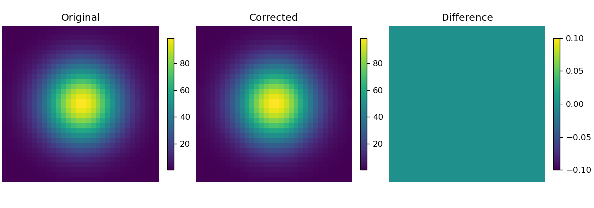

# Synthetic example: Two-run zero-distortion phantom

Download the [repository ZIP with the example and readiness fixes](https://github.com/MPG-Git/FSL_Windows_WSL2_TOPUP/archive/refs/heads/main.zip),
extract it to a writable folder, and follow the setup below. The ZIP comes from
main and includes the readiness fixes and example files.
The input files and reference outputs are already included; generation is optional.

## Run and inspect

This is a Linux/FSL command-line workflow. On Windows, run it **inside WSL2**
after installing FSL according to the main repository setup guide. From the
extracted repository in a Linux/WSL shell:

```bash
export FSLDIR="$HOME/fsl" # change this if FSL is installed elsewhere
source "$FSLDIR/etc/fslconf/fsl.sh"
export PATH="$FSLDIR/share/fsl/bin:$PATH"
"$FSLDIR/bin/python" examples/synthetic/run_demo.py
```

FSL's Python must have NumPy, NiBabel and Matplotlib. The reference FSL version
is recorded in `expected/fsl_version.txt`. The data contain a 32 x 32 x 32
Gaussian phantom (3 mm voxels, arbitrary signal units), two task amplitudes,
identical opposing-encoding images, and two volumes per BOLD run. JSON sidecars
specify `j-`/`j` directions and 0.05 s total readout time. This minimal BIDS-like
layout is intended for this pipeline, not comprehensive BIDS validation.

The runner first copies the inputs to `output/working_data`, then runs the
actual TOPUP/applytopup pipeline with two workers. Your bundled inputs stay
unchanged. Both tasks must produce finite corrected 32 x 32 x 32 x 2 data on
the original grid. It saves `one_corrected.nii.gz`, `two_corrected.nii.gz`,
previews, `metrics.json`, `comparison.csv` and `pipeline.log`.

Identical opposing images encode **zero distortion**. Corrected images must
match both their input and the included reference NIfTIs with relative L2 error
below **0.05**. The reference errors versus input were about 1.68e-8 and 1.38e-8.
This validates execution, metadata routing and task isolation; it does not
test recovery of a nonzero field or accuracy on a real acquisition.



Recreate inputs with `"$FSLDIR/bin/python" examples/synthetic/generate_data.py new_data`.
For another run use `--outdir demo_run_2` with the demo command.

## What counts as success

A successful run prints `PASS` and writes `PASS.txt` and `comparison.csv` into
the new output folder. Errors and mismatches stop the runner without a PASS file.
Open the CSV comparison and compare your plots with `expected/`.
The included reference outputs came from actual runs on November 7, 2026.

The default output is this example's `output/` directory. Existing output folders
are refused so a previous result cannot be mistaken for a fresh run.

If a comparison fails, inspect the reported metric and confirm that you used
these bundled files, this repository version, and the listed dependencies.
Do not replace the reference with the failing result. `SHA256SUMS.json` records
input/reference file hashes for download-integrity checks. All input data are
generated; no participant recordings or personal data are included. The supplied
generators refuse to overwrite an existing destination.

These examples check the illustrated installation and workflow, not every menu
item or scientific validity for a particular study. Reference plots may render
differently with another operating system or graphics version.
